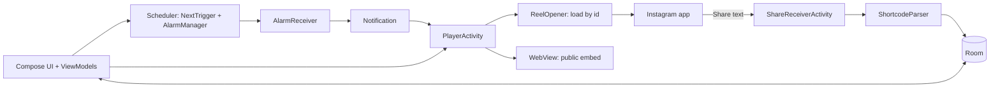

# TRD: ReelReminder
## Architecture

## Stack (reason / rejected alternative)
Kotlin + Jetpack Compose (share target, exact alarms, notifications are native APIs / rejected: PWA, Expo for this MVP, see ADR-1). Room (local relational data, migrations). AlarmManager exact alarms (user-visible reminders at exact times) + WorkManager only for non-time-critical work. Coil (image loading). Material3 date/time pickers with light theme. java.time for schedule maths.
## Data model (Room)
Reel(id PK, shortcode, url, note, categoryId FK, coverPath?, startDate, time, zoneId, repeat, every, unit, days, endType, endDate?, endCount?, firedCount, done, paused, createdAt, updatedAt). Category(id PK, name, gradientStart, gradientEnd, sortOrder). WatchLog(id PK, reelId FK, watchedAt). Settings in DataStore (theme, open method). Migration required from the installed version (Issue 11).
## API specification
NOT APPLICABLE: there is no backend. (If the optional oEmbed proxy is ever built it needs its own spec, auth and rate limits.)
## Auth design
NOT APPLICABLE (single local user, no accounts). No tokens or passwords exist.
## Critical data flows
1 Save: Instagram Share -> ShareReceiverActivity -> parse + validate -> reel sheet (prefilled) -> save -> NextTrigger -> alarm set.
2 Fire: alarm -> receiver loads reel by id -> notification (PendingIntent unique per reel) -> tap -> PlayerActivity(reelId) -> load by id -> show/open exact reel -> reschedule next occurrence.
3 Play from app: any Play button -> ReelOpener.open(reelId) -> Room by id -> method chosen in ADR-3.
## Environments
dev (debug build), CI (GitHub Actions), release (tagged APK). No server environments. Secrets: none in the app; keystore + tokens only as CI secrets/owner machine.
## Non-functional targets
Cold start < 2 s (measure); alarm accuracy per OS exact-alarm behaviour (measure); APK size reported; no network except embed player.
## Security design and threat model
Assets: the user's saved links/notes (low sensitivity). Threats: malicious shared text/intents -> strict validation, allowlist; malicious WebView content -> JS only for embed, domain allowlist, no bridge/file access; PendingIntent hijack -> FLAG_IMMUTABLE, explicit component; secrets leakage -> none in app, gitleaks; tampered APK -> SHA-256 published, signed releases (ADR-7).
## Observability
Local structured logs (no personal data), Debug screen (last shared, open method log). No remote telemetry.
## Testing strategy and gates
See docs/TEST_PLAN.md and docs/brief/M05_QUALITY_GATES.md.
## Deployment, rollback, backup
Tag `pre-v6` = rollback point. Release via GitHub Release; rollback = previous release. User data backup = in-app Export/Import (Issue 17). Site: Vercel, rollback = previous deployment.
## Third-party services and limits
GitHub (repo, Actions, Releases) and Vercel (static site): limits and pricing UNKNOWN, verify at decision time (FRESHNESS rule).
## Risks and ADRs
See docs/DECISIONS.md.
